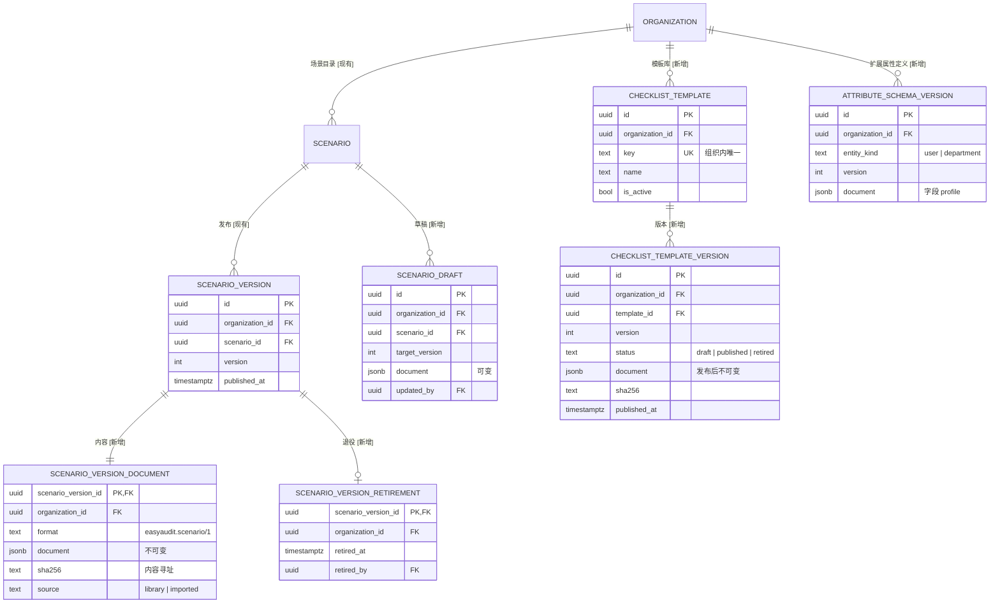
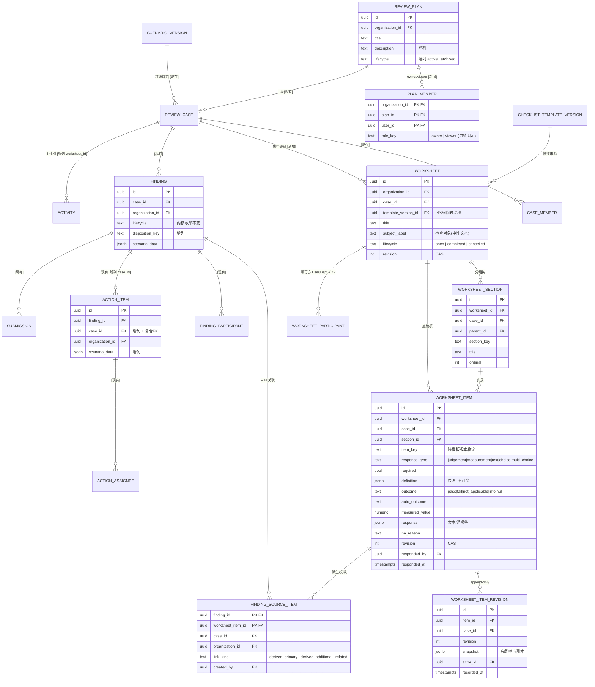
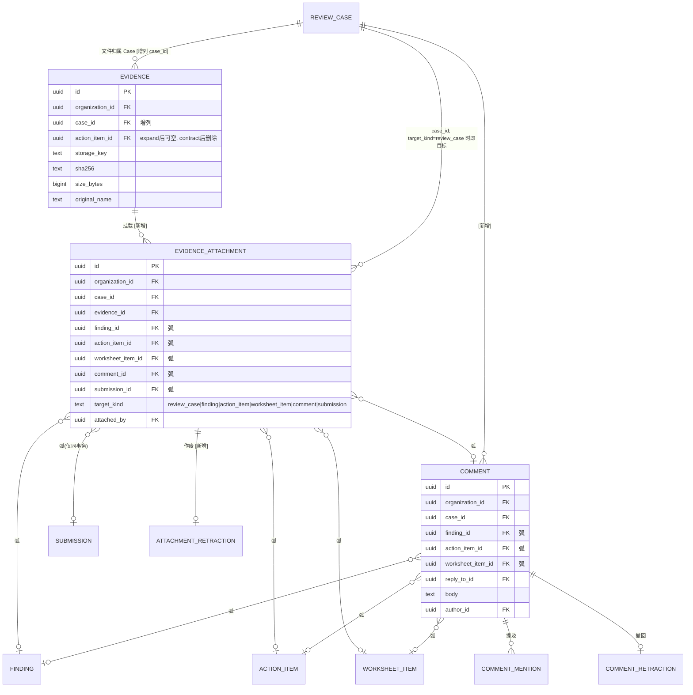
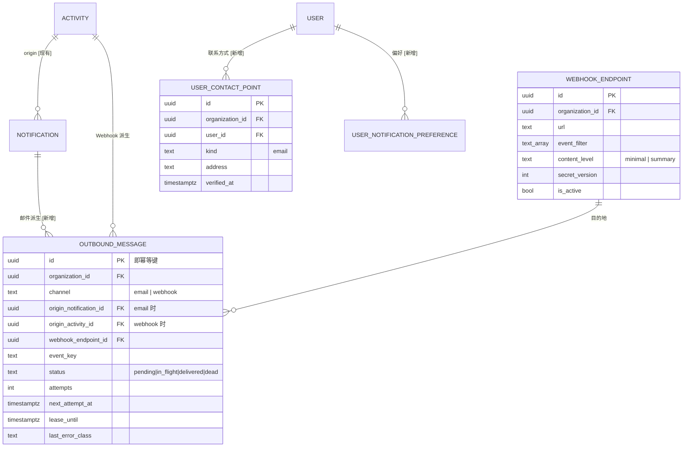
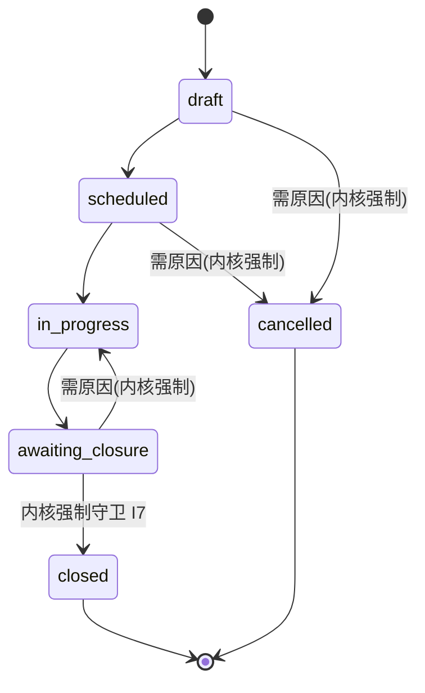
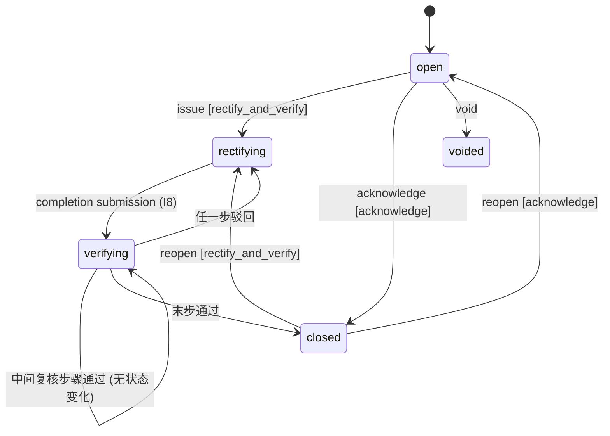

# 02 通用审查元模型与领域模型规范（Meta-Model RFC）

- 状态：提案（RFC），待维护者拍板
- 基线：`origin/main` `5a2804b`（2026-10-13）
- 相关：[README](README.md) · [01 现状与断层](01-current-state-and-gaps.md) · [03 扩展与协作](03-extension-and-collaboration.md) · [04 路线图](04-roadmap-and-dod.md)
- 约束：数据模型保持通用，不含任何行业专有概念。示例只用中性键名，如 `scope_note`、`requires_action`、`record_only`、`respondent`。

## 1. 术语

| 术语 | 含义 |
|---|---|
| 内核（Kernel） | `review_core` 中不随场景变化的部分：实体、状态集合、迁移包络、不变量、锁序、授权管线、权限词表 |
| 引擎（Engine） | 内核里的纯 Python 解释器。它读取场景文档，实现现有的 `ScenarioPolicy` Protocol；随代码发版，同一文档格式版本内语义冻结 |
| 场景文档（Scenario Document） | 某组织某场景某版本的声明式定义，发布后不可变，用 sha256 标识 |
| 包络（Envelope） | 内核为每类实体规定的"结构上合法的迁移边"全集；文档只能从中挑选 |
| 处置（Disposition） | 文档定义的发现项分类。每个处置绑定一条内核轨道（Track） |
| 检查模板 / 模板版本 | 可复用的检查项定义库；模板版本一经发布即不可变 |
| 执行底稿（Worksheet） | Case 下由模板版本快照而来的实例，承载逐项填写的结果 |
| 结果类别（Outcome Class） | 内核封闭集合：`pass`、`fail`、`not_applicable`、`info`。选项的显示标签由模板定义 |
| 挂载（Attachment） | 证据文件与一个目标对象之间不可变的关联 |

## 2. 四层模型

| 层 | 内容 | 如何变更 | 可变性 |
|---|---|---|---|
| L0 内核（代码） | 实体与表；Case/Finding/Action 状态集合；迁移包络；内核强制守卫；权限词表；守卫库；字段类型库；结果类别；处置轨道；锁序；授权管线；Worksheet 状态机 | 代码 PR + ADR | 随发版 |
| L1 引擎（代码） | 文档格式 `easyaudit.scenario/1` 的解释器、静态校验器、差分与示例测试运行器 | 代码 PR。同一格式版本内只能**新增**守卫或字段类型，不得改变已有语义 | 随发版，语义冻结 |
| L2 版本化元数据（数据） | 场景文档（角色、授权、迁移选择、守卫参数、处置、表单、收件人、通知规则、底稿策略）；检查模板版本 | 草稿 → 校验 → 发布（CLI 或管理 API） | 发布后不可变（触发器保证） |
| L3 组织配置（数据） | Webhook 端点、通道开关、用户联系方式与偏好、扩展属性定义、模板库目录 | 管理界面，写平台审计 | 可变，有审计 |

> 判定原则：**凡是会改变"已有 Case 的历史如何被解释"的内容，必须放在 L0/L1（随代码版本化）或 L2（不可变）；只影响"从现在起如何送达、如何展示"的内容，放在 L3。**

## 3. ERD（纯抽象；标注 [现有] / [新增] / [增列]）

### 3.1 定义层



### 3.2 执行层



### 3.3 证据与协作



**以 Case 本身为目标（证据挂载和评论都支持）。**典型用途是活动级材料，例如范围说明、计划安排、结项归档材料的附件。

- **数据形态**：所有弧列都为 NULL，`target_kind='review_case'`。此时目标就是行上已有的 `case_id`，它已经通过 `(case_id, organization_id)` 复合 FK 指向 `review_cases`，所以不需要新增弧列。
- **约束**：以挂载为例，CHECK 写作 `num_nonnulls(finding_id, action_item_id, worksheet_item_id, comment_id, submission_id) = CASE target_kind WHEN 'review_case' THEN 0 ELSE 1 END`，再逐列校验非空列与 `target_kind` 一致。评论同理，只是弧列为 finding、action_item、worksheet_item。
- **授权**：挂载到 Case 需要 `add_case_evidence`（由场景文档映射，例如映射给审查组长、审查员）；查看需要 `view_case`。只持有 Finding 或 Action 授权的人看不到 Case 级证据，这与"上下文按目标构造"的原则一致（§8）。
- **生命周期**：除 `cancelled` 以外的任何 Case 状态都可以挂载，包括 `closed`（用于归档结项材料）。场景文档可以用守卫 `case_lifecycle_in` 进一步收窄。挂载只追加记录，不改变任何生命周期。
- **为什么不改用"通过评论挂载"**：Case 级材料是正式证据，要进入卷宗证据清单和"已附证据"统计。如果放在评论里，会和讨论内容混在一起，而且评论撤回与挂载作废的语义也不同。

### 3.4 投递



## 4. 实体与不变量

沿用 `docs/domain.md:36-46` 的不变量 I1–I9，并新增以下不变量。每条都必须有对应的数据库约束或测试。

| 编号 | 不变量 | 保证方式 |
|---|---|---|
| M1 | 已发布的场景文档和模板版本不可修改、不可删除 | 触发器 `reject_*_mutation`，与 `scenario_versions` 同法（`alembic/versions/20260821_0004_m1_3_scenario_persistence.py:91-100`） |
| M2 | Case 只按其 `scenario_version_id` 对应的文档解释，且文档 sha256 与内容一致 | 发布时计算 sha256，引擎加载时复核；不一致返回 500 并记 ERROR（视为数据损坏） |
| M3 | 文档只能引用包络内的迁移、权限词表内的权限、守卫库内的守卫 | 发布时静态校验，引擎加载时再校验一次 |
| M4 | 每份文档至少有一个"创建者角色"，且它拥有 `manage_case_members`，使 I9 从 Case 创建起就成立 | 静态校验 |
| P1 | 每个计划至少有一名活跃 owner；已归档的计划不能追加活动 | 在 Plan 锁内检查并配测试（同 I9 的做法） |
| W1 | Worksheet、Section、Item 与所属 Case 同组织、同 Case | 复合 FK `(worksheet_id, case_id, organization_id)` |
| W2 | 底稿项的 `definition`、`response_type`、`required`、`item_key` 创建后不可变，只有响应列和 `revision` 可以修改 | 列级触发器（`OLD.definition IS DISTINCT FROM NEW.definition` 时报错） |
| W3 | 每次响应变更都对应一条修订，`revision` 严格递增 | 同一事务写入；`UNIQUE(item_id, revision)`；修订表 append-only |
| W4 | 只有在 Case 处于文档声明的可填写状态（包络为 `scheduled`/`in_progress`）且 Worksheet 为 `open` 时才能填写 | 锁内守卫 |
| W5 | 一个底稿项最多有一个 `derived_primary` 关联 | 部分唯一索引 `WHERE link_kind='derived_primary'` |
| W6 | 关联的两端属于同一个 Case | 复合 FK |
| E1 | 证据文件与它的所有挂载同属一个 Case、一个组织 | 挂载表对文件和目标都使用 `(x_id, case_id, organization_id)` 复合 FK |
| E2 | 文件、挂载、作废记录都是 append-only；已作废的挂载不计入"已附证据" | 触发器 + 读侧过滤 |
| E3 | 挂到 Submission 上的挂载只能与该 Submission 在同一事务中创建 | 应用规则 + 测试（Submission 本身不可变） |
| E4 | 以 Case 本身为目标的挂载，只能在 Case 不处于 `cancelled` 时创建（`closed` 允许，用于归档结项材料） | 在 Case 锁内用守卫检查，并配测试 |
| C1 | 评论不可修改；撤回以追加记录实现，读侧隐藏正文 | 触发器 |
| O1 | outbox 行与触发它的 Activity 或 Notification 在同一事务提交；同一目的地对同一来源事件只入队一次 | 唯一约束 `(organization_id, channel, destination_key, origin_key, event_key)` |
| O2 | 外发投递语义是至少一次，接收方用消息 `id` 去重 | 文档约定 + 签名头携带 id |

## 5. 状态机（标注哪些沿用内核）

### 5.1 ReviewCase：沿用内核，状态集合与边都不变



包络就是图中这 7 条边，即现有两个场景所用边的并集（`src/easyaudit_next/scenarios/process_review/v1.py:203-246`）。

- 文档可以：给边命名 `action`、指定所需权限、附加**可选守卫**（例如给 `finish_fieldwork` 加 `worksheets_completed`）、提供中文标签。
- 文档不可以：增删状态、增加包络外的边、去掉内核强制守卫。

### 5.2 Finding：沿用内核，处置轨道选择子图

包络取现有两个场景所有边的并集：

| 边 | 命令形态 | 内核强制守卫 | `rectify_and_verify` | `acknowledge` |
|---|---|---|---|---|
| open → rectifying | direct | — | ✓（签发） | — |
| open → closed | direct | — | — | ✓（确认/接受） |
| open → voided | direct | 需原因 | ✓ | ✓ |
| rectifying → verifying | submission（completion） | I8：至少一个未取消的整改项，且全部 done | ✓ | — |
| verifying → closed | submission（verification，末步通过） | 复核步骤全部通过（见 03 §2） | ✓ | — |
| verifying → rectifying | submission（verification，任一步驳回） | 需原因 | ✓ | — |
| closed → rectifying | reopen | 需原因；Case 未关闭 | ✓ | — |
| closed → open | reopen | 需原因；Case 未关闭 | — | ✓ |



"观察项直接关闭"和"需整改项走整改-验证"在内核里是同一个状态机、同一组边，处置只决定**走哪条轨道**。轨道是内核封闭集合，目前只有两条。如果将来确实需要第三种（例如"整改后免验证关闭"），它要用到包络外的边（rectifying → closed），那就是内核变更，必须走 ADR。这是元数据化的硬边界。

- `findings.disposition_key` 在创建时确定，引擎保证它是文档声明的处置之一。是否允许在 `open` 状态重新分类见 Q7；如果允许，新增 `reclassify` 命令：只在 `open` 状态可用，写 Activity，不改 lifecycle。
- @1 兼容：`compliance_review@1` 的文档声明 `disposition_source: {"field": "finding_type"}`，创建时由引擎把 `scenario_data.finding_type` 复制到新列，API 契约不变。`process_review@1` 只有一个隐式处置 `default`（轨道为 `rectify_and_verify`）。迁移按同样规则回填历史行。

### 5.3 ActionItem：沿用内核，不开放元数据旋钮

状态转换：`todo → in_progress → done`；`todo/in_progress → cancelled`（需原因）；`done → in_progress`（reopen 或 transfer_and_reopen）。两个场景的整改项规则逐字一致（`src/easyaudit_next/scenarios/process_review/rectification.py:56-142`），因此格式 v1 把这些规则升格为**内核默认规则**，文档只配置角色到权限的映射和表单。

### 5.4 Worksheet：新增，由模块代码定义，不开放元数据

```mermaid
stateDiagram-v2
  [*] --> open : 挂载模板版本(生成快照)
  open --> completed : complete (守卫: 必填项完成 + 证据要求满足)
  completed --> open : reopen (需原因; Case 处于可填写状态)
  open --> cancelled : cancel (需原因; 无派生发现项)
  completed --> [*]
  cancelled --> [*]
```



| Case 状态 | 底稿可执行的操作 |
|---|---|
| draft / scheduled | 挂载或取消底稿（生成快照），指派填写方；如果文档的 `respond_in` 包含 `scheduled`，还可以预填（Q11） |
| in_progress | 填写、完成、重开、派生或关联发现项、上传证据 |
| awaiting_closure | 只读（需要补录时走 Case 的 `reopen_fieldwork`） |
| closed / cancelled | 只读 |

文档可以给 Case 的 `finish_fieldwork` 加两个可选守卫：
- `worksheets_completed`：所有未取消的底稿都已完成。
- `nonconformities_resolved`：每个结果为 `fail` 的项，要么有关联的发现项，要么记录了"不派生理由"。

### 5.5 其他新增状态机

- 场景版本、模板版本：`draft →(publish)→ published →(retire)→ retired`。退役只影响能否用于新建，不影响已经绑定的 Case 或底稿。
- 计划：`active ⇄ archived`。归档后不能追加活动，已有活动不受影响。
- 外发消息：`pending →(claim)→ in_flight →(ok)→ delivered`。失败则回到 `pending` 并设置 `next_attempt_at`（指数退避），超过最大次数变为 `dead`。租约过期的 `in_flight` 按 `pending` 处理。`dead` 可以由管理员重新入队（见 03 §3）。

## 6. 租户隔离与外键策略

1. 每张新表都有 `organization_id`，每个 FK 都是含 `organization_id` 的复合 FK，与现状一致。
2. **Case 作用域规则（新）**：属于某个 Case 的表都带 `case_id`，并通过 `(x_id, case_id, organization_id)` 复合 FK 指向父表；父表提供 `UNIQUE(id, case_id, organization_id)`。
   - `findings` 已具备（`src/easyaudit_next/review_core/persistence/models.py:195-197`）。
   - 需要新增的表：`action_items`、`submissions`、`evidences`、`worksheets`、`worksheet_items`、`comments`。
   - 效果：挂载、评论、关联这三类跨对象关系**由 FK 证明同属一个 Case**，跨 Case 的引用在数据库层就写不进去。
3. 互斥弧的写法：类型化可空 FK + `num_nonnulls(...)` CHECK + `target_kind` 一致性 CHECK。不使用 Generic FK（ADR-0005）。
4. 不可变表使用 `BEFORE UPDATE OR DELETE` 触发器，错误码 55000，与现状一致。
5. 定义层（场景文档、模板版本）按组织隔离。仓库内置的场景库文档可以发布到多个组织：内容相同，各组织各存一行。
6. 每张新表都要有正向测试和跨组织拒绝测试；涉及主体时 User 与 Department 都要覆盖。这些测试进入 CI（ADR-0005 验收条款）。
7. `action_items.case_id` 的迁移步骤：
   1. 增列（可空）；
   2. 用 `findings.case_id` 回填；
   3. 设为 NOT NULL；
   4. 加复合 FK `(finding_id, case_id, organization_id) → findings(id, case_id, organization_id)`；
   5. 加 `UNIQUE(id, case_id, organization_id)`。

   `action_items` 上没有触发器，回填就是普通的 `UPDATE`。升级流程在迁移前已经停止应用（`deploy/README.md:178-181`），所以回填期间没有并发写入。downgrade 只需删列：该列可以推导，删除不丢信息。
8. **在已有触发器保护的表上增列、回填**。下表逐一核对了现有全部触发器（`alembic/versions/` 中所有 `CREATE TRIGGER`）与本 RFC 计划的变更：

   | 表 | 触发器 | 计划变更 | 是否被拦截 | 做法 |
   |---|---|---|---|---|
   | `evidences` | `evidences_reject_mutation`：`BEFORE UPDATE OR DELETE`，无条件 `RAISE`（55000）（`alembic/versions/20260826_0008_m2_4_rectification.py:74-90`） | P3：新增 `case_id` 并回填；P4 contract 的 downgrade：恢复 `action_item_id` 并回填 | **会**：回填是逐行 `UPDATE` | 在迁移内暂停该触发器，规则见下方，取舍见 D8 |
   | `submissions` | `submissions_reject_mutation`（同上，`:92-108`） | P3：新增 `UNIQUE(id, case_id, organization_id)`，`case_id` 列已存在 | 否：建唯一索引不修改行 | — |
   | `activities` | `activities_reject_mutation`（`alembic/versions/20260821_0005_m1_4_review_core_persistence.py:428-444`） | P4：新增可空 `worksheet_id` 弧列，替换 `ck_activities_exactly_one_target` | 否：不带默认值的 `ADD COLUMN` 不写行；新 CHECK 只扫描校验 | downgrade 时若存在 `worksheet_id` 非空的行，拒绝执行 |
   | `notifications` | `trg_notifications_immutable`：按**列清单**拒绝修改（当前版本见 `alembic/versions/20260827_0011_m3_4_notification_origins.py:83-118`）；`trg_notifications_origin_organization` | P6 的"类别 + 事件键"**不新增列**：沿用 `kind` 列作为事件键，类别由读侧代码映射。若要给底稿通知新增 `worksheet_id` 主体弧列，同样不需要回填 | 否：没有回填。**但**新列不在函数的列清单里，会变成可修改 | 凡给 `notifications` 增列的迁移，都必须 `CREATE OR REPLACE` 这个函数，把新列加进不可变清单（0011 加入 `automatic_origin_key` 时就是这样做的），并测试对新列的 `UPDATE` 被拒绝 |
   | `scenario_versions` | `scenario_versions_reject_mutation`（`alembic/versions/20260821_0004_m1_3_scenario_persistence.py:86-102`） | 无：文档内容放进新表 `scenario_version_documents`（D3） | 不涉及 | 有意不改这张表 |
   | `platform_audit_events` | `platform_audit_events_reject_mutation` | 无 | 不涉及 | — |
   | `departments` | `departments_reject_cycle`：只在 `INSERT` 或 `UPDATE OF parent_id, organization_id` 时触发 | P8：新增 `attributes JSONB DEFAULT '{}'` | 否：常量默认值的 `ADD COLUMN` 只改元数据，也不涉及这两列 | — |
   | `action_items`、`findings`、`review_plans`、`users` | 无 | P3 `action_items.case_id` 回填；P1 `findings.disposition_key` 回填；P2、P5、P8 增列 | 否 | 普通 `UPDATE`（见第 7 条） |

   **迁移内暂停触发器的规则**（只适用于上表"会"被拦截的情况）：
   - **固定顺序**：同一个迁移函数内依次执行：先取得该表的 `ACCESS EXCLUSIVE` 锁（同一函数里的 `ADD COLUMN` 会拿到这把锁；如果回填与增列不在同一个迁移里，就显式执行 `LOCK TABLE … IN ACCESS EXCLUSIVE MODE`）→ `ALTER TABLE … DISABLE TRIGGER <触发器名>` → 回填 → `ALTER TABLE … ENABLE TRIGGER <触发器名>`。回填只写能从既有不可变事实推导出的新列。
   - **原子性**：整个 `alembic upgrade` 跑在一个事务里（`alembic/env.py:39-42`，没有开启 `transaction_per_migration`）。PostgreSQL 的 DDL 是事务性的，迁移失败回滚时触发器的启用状态也一起恢复。表上的 `ACCESS EXCLUSIVE` 锁一直持有到提交（`DISABLE TRIGGER` 本身只需要 `SHARE ROW EXCLUSIVE`），这期间其他会话无法读写这张表。
   - **只停这一个**：按名字只停用这一个触发器。不用 `DISABLE TRIGGER ALL`，它会连同外键的约束触发器一起停掉；也不用 `session_replication_role`，它需要超级用户，而且是作用于整个会话的开关。
   - **迁移测试**：必须断言三件事：回填结果正确；回填后 `pg_trigger.tgenabled = 'O'`；对该表执行 `UPDATE`、`DELETE` 仍然抛出 55000。
   - **静态检查**：用单元测试扫描 `alembic/versions/`。凡是出现 `DISABLE TRIGGER x` 的迁移函数，后面必须出现 `ENABLE TRIGGER x`，并且 `x` 在允许名单里。

## 7. 锁顺序扩展

全局顺序：只能从左往右加锁，**禁止反向**。

```text
IdempotencyKey → Organization → ReviewPlan → ReviewCase → User(按 ID 排序, 一条语句)
  → Worksheet → WorksheetItem(按 ID 排序) → Finding → ActionItem
  → { Assignee / Submission / Evidence / EvidenceAttachment / Comment / Link 插入 }
```

| 路径 | 锁序 | 说明 |
|---|---|---|
| 计划成员增删、归档 | `Plan` | 只锁计划；最后一名 owner 的保护在锁内判断 |
| 新建活动并挂到计划 | `IdempotencyKey → Plan(FOR NO KEY UPDATE) → 插入 Case` | 与 Case 锁同理：在 Plan 锁内重读计划成员，授权 `plan.manage`，检查计划为 `active`。不存在"先持有 Case 再取 Plan"的路径 |
| 挂载或取消底稿 | `Case → Worksheet(CAS)` | 快照用多值 `INSERT … VALUES` 在同一个短事务内批量写入 |
| 填写底稿项（含批量） | `Case → Worksheet(读) → Item(按 ID 排序，CAS revision)` | Case 锁同时承担锁内授权；批量保存在一个事务内全有或全无 |
| 完成或重开底稿 | `Case → Worksheet(CAS lifecycle)` | 与填写操作通过 Case 锁串行 |
| 派生发现项 | `Case → Worksheet → Item(CAS) → 插入 Finding → 插入关联` | 新建的 Finding 不需要加锁；以主派生唯一索引作为最终仲裁 |
| 关联已有发现项 | `Case → Worksheet → Item → Finding(NO KEY UPDATE)` | Worksheet 必须排在 Finding 之前 |
| 证据上传第 3 段 | 目标为 Action：`Case → Finding → Action`（沿用现状）；目标为 Finding：`Case → Finding`；目标为底稿项：`Case → Worksheet → Item`；目标为评论或 Case 本身：`Case` | 三段事务管线不变，只是按目标解析锁序 |
| 挂载已有文件、作废挂载 | 与上一行相同的目标锁序 | 只追加记录 |
| 发表评论、提及 | `Case → 插入 Comment / Mention / Notification` | 授权要求先取 Case 锁（`docs/architecture.md:119-122`） |
| 多步复核 | `Case → Finding → Submission`（沿用验证路径） | 只有末步通过才 CAS 修改 lifecycle |
| Case `finish_fieldwork`（带底稿守卫） | `Case →（读 Worksheet/Item/关联，不加锁）` | 所有底稿写入都先取 Case 锁，所以在 Case 锁下读到的就是确定结果 |
| outbox 分发 | 只锁 `outbound_messages`（叶子行，`FOR UPDATE SKIP LOCKED`），**从不锁业务行** | 加入 `check_architecture.py` 的 FOR UPDATE 白名单，与 `local_credentials` 同类 |
| 模板发布 | `ChecklistTemplate → 插入版本` | 与 Case 路径没有交集 |

新增规则：

- 持有 Finding 锁之后，不得再取 Worksheet 或 Item 的锁。`check_architecture.py` 能检查的部分就检查；派生与关联两条路径另用双 Session 测试固定。
- **同一 Case 内的底稿写入在 Case 行上串行，这是有意的取舍。**锁内授权依赖 Case 行上的 `FOR NO KEY UPDATE`：成员移除和用户停用持有同一把锁（`docs/architecture.md:119-123`）。如果改用 `FOR KEY SHARE`，它与 `FOR NO KEY UPDATE` 不冲突，角色撤销可以在填写的授权与写入之间提交，锁后授权的保证就失效了。PostgreSQL 的行锁也没有"意向锁"语义。缓解办法：短事务、批量保存、用 300 项底稿压测。只有实测 P95 明显退化时，才另做专门评估。
- 每条新路径都要有双 Session 竞争测试：
  - 撤销角色 vs 填写（锁后授权）；
  - 两人同时保存同一项（其中一个得到 409）；
  - 重复点击派生（只产生一个 Finding）；
  - `finish_fieldwork` vs 重开底稿；
  - 归档计划 vs 追加活动。

## 8. 授权模型扩展

**权限词表**放在内核 `review_core/domain/permissions.py`，P0 落地。文档只能引用词表中的权限，以及复核步骤的命名空间权限 `step:<key>`。

| 已有（17 个） | 新增 |
|---|---|
| `create_case`、`view_case`、`view_finding`、`manage_case_members`、`transition_case`、`create_finding`、`issue_finding`、`accept_observation`（别名 `acknowledge_finding`）、`manage_finding_participants`、`create_action`、`manage_action_assignees`、`update_assigned_action`、`add_rectification_evidence`、`transfer_and_reopen_action`、`submit_rectification`、`verify_finding`、`reopen_finding` | `view_worksheet`、`manage_worksheets`、`fill_worksheet`、`complete_worksheet`、`reopen_worksheet`、`derive_finding`、`add_case_evidence`、`add_finding_evidence`、`add_worksheet_evidence`、`retract_evidence`、`comment`、`moderate_comments`、`export_case`、`reclassify_finding`（取决于 Q7）、`step:<key>` |

**授权表达式（写在文档里）**：形式为 `permission → any_of[选择器]`。选择器为 `{scope: organization|case|finding|action|worksheet, roles: [...], via: direct|department_membership}`；其中 `scope: organization` 只允许取值 `active_user`。选择器与现有的 `RoleGrant(role_key, actor_kind, source)`（`src/easyaudit_next/review_core/domain/scenario_capabilities.py:86-92`）一一对应，所以 `AuthorizationContext` 只需新增一个 `worksheet_role_grants` 字段，旧的代码 Policy 不受影响。

**上下文按目标构造**（延续 `docs/architecture.md:127`）：

- **Worksheet**：父 Case 的授权，加上本 Worksheet 的参与方授权。被指派填写的一方（例如被检查部门）只能看到分给自己的底稿，看不到整个 Case。
- **挂载**：按挂载目标的上下文判断；目标是 Case 本身时，使用 Case 上下文（挂载需要 `add_case_evidence`，查看需要 `view_case`）。下载文件的条件是：执行者能查看该文件的任一挂载目标（已作废的挂载也算，作为历史保留）。不存在、跨组织、无权限三种情况一律返回同一个 404，沿用 `docs/architecture.md:263`。
- **评论**：按评论目标的上下文判断，并要求 `comment` 权限。撤回自己的评论不需要额外权限；撤回他人的评论需要 `moderate_comments`。
- **计划**：使用内核固定的计划角色。`owner` 可以管理计划、追加活动、查看进度；`viewer` 只能查看进度。计划不属于任何场景，所以不走场景授权（D14）。

## 9. 关键决策

### D1 元数据边界

- **选择**：内核保留"什么是合法的"，文档决定"本场景启用哪些、由谁做、填什么"，分工见下表。
- **理由**：红线 1 要求内核状态机不变，ADR-0003 要求不可变、可测试；"包络加选择"能同时满足这两条。任何文档都无法让 Case 进入内核不认识的状态，也绕不过 I7、I8、I9。
- **被否决**：
  - ①通用表达式守卫（CEL、JSONLogic、受限 Python、可组合的谓词 AST）：守卫需要读哪些事实无法静态得知，锁内加载会遗漏（TOCTOU）；错误码由作者自造，前端没有映射；也无法证明不变量成立。
  - ②在数据库里配置状态集合：直接违反红线 1，读侧（工作台、管理视图、导出、提醒的逾期规则）要全部重写。

| 归属 | 项目 |
|---|---|
| **内核代码** | 状态集合；包络；内核强制守卫（I7 关闭时发现项须全部终态；I8 进入验证须整改项完成；I9 至少一名管理者；负向终止边须填原因；`finding.reopen_after_case_closure`；`verification.case_closed`）；整改项默认规则；权限词表；守卫库；字段类型库与校验器；结果类别；处置轨道；锁序；授权管线；Worksheet 状态机；提交保留键（`stage`、`result`、`step`） |
| **场景文档（不可变）** | 角色目录（键、主体类型、权限来源、中文标签、是否为创建者角色）；授权表达式；启用的迁移（action 键、标签、是否需确认、守卫及参数）；处置及其轨道和默认严重度；表单（Case、Finding、Action、各类提交）；复核步骤；收件人意图映射；通知规则；底稿策略（`respond_in`、`finish_fieldwork` 守卫、允许的模板）；可执行示例 |
| **组织配置（可变）** | 通道开关、Webhook、联系方式与偏好、扩展属性、模板库目录 |

**守卫怎样声明、怎样测试。**以"签发前必须已指定某些参与方角色"为例：

```json
{ "action": "issue", "from": "open", "to": "rectifying", "permission": "issue_finding",
  "guards": [ { "use": "participants_present", "params": { "roles": ["owner", "responsible_department"] } } ] }
```

`participants_present` 是守卫库里的纯函数：`(FindingFacts, params) → None | RuleViolation(finding.missing_participant_roles, {roles: 缺失列表})`。它要用的事实 `participant_role_keys` 已由内核在锁内加载（`src/easyaudit_next/review_core/domain/scenario_capabilities.py:109-122`）。可测试性分三层：守卫库单元测试；文档 `examples` 在发布时执行；差分测试与金样测试（03 §1.5）。

### D2 引擎实现现有 Protocol

- **选择**：`DeclarativeScenarioPolicy(document)` 提供 `case_workflow`、`finding_workflow`、`finding_operations`、`finding_direct_transitions`、`action_*`、`authorization`、`collaboration_recipients`、`submission_policy` 和 `validate_*_input`，签名完全不变。Registry 改为按 `scenario_version_id` 解析，并按 sha256 缓存 Policy。
- **理由**：锁内授权、CAS、Activity 写入都在应用服务里，而应用服务只依赖 Protocol。这是满足红线 1 最直接的方式：内核代码只在组合根和 Registry 解析两处有改动。
- **被否决**：重写应用服务、让它直接读元数据。改动会覆盖 `src/easyaudit_next/review_core/application/` 下近 3,000 行代码，几十个并发测试要重新论证。

### D3 版本化、发布与绑定

- **选择**：
  - 生命周期：草稿（`scenario_drafts`，可变）→ 校验（静态校验 + examples）→ 发布 → 退役。发布在同一事务内插入 `scenario_versions` 和 `scenario_version_documents`，sha256 对规范化 JSON 计算（键排序、无空白、UTF-8）；退役是追加一条 `scenario_version_retirements`。
  - Case 仍然只存 `scenario_version_id`。
  - 引擎按 `format` 的主版本分派解释器。同一格式版本内只能**新增**守卫名或字段类型，已有守卫的语义冻结；要改语义，就起一个新守卫名或升格式主版本。
- **理由**：版本行本身已经不可变，并且被 RESTRICT FK 引用（`src/easyaudit_next/review_core/persistence/models.py:115-120`），引用它就相当于快照。文档按内容寻址，缓存永远不需要失效。
- **被否决**：
  - ①每个 Case 复制一份文档：冗余，还会让人误以为同一版本下不同 Case 的内容可能不同。
  - ②允许"热修"已发布文档：破坏历史解释的唯一性，违背 ADR-0003。

### D4 现有场景与数据的无损迁移

- **选择**（在 P1 内按顺序完成）：
  1. 把与代码等价的文档写进仓库场景库，**中文标签从前端适配器迁入**（如 `web/src/scenarios/processReviewV1.tsx:35-40,132-180`）。
  2. 做差分测试：对"内核状态 × action × 上下文布尔组合 × 角色授权组合 × 载荷变体（缺失、空白、带首尾空格、非法选项）"的网格穷举，逐项比较代码 Policy 与声明式 Policy 的判决（目标状态、`RuleCode`、`params`、`errors[]`），必须全部相等。
  3. 迁移：为每条已有的 @1 `scenario_versions` 行插入一条 `scenario_version_documents`。文档 JSON **内嵌在迁移文件里**（迁移不能依赖会变化的应用代码），并核对 sha256。
  4. 回填 `findings.disposition_key`：compliance 取 `scenario_data->>'finding_type'`，process 取 `'default'`。
  5. Registry 切换到声明式实现。代码版 @1 只保留一个发版周期，仅供差分测试使用，下一个发版删除（Q6）。
- **不改动的数据**：
  - `review_cases.scenario_version_id`；
  - `scenario_data` 的键与值；
  - `activities.event_type` 与 `metadata`：文档为每条迁移声明的 `activity_event` 与现有字符串一致；
  - `submissions.payload`：@1 表单沿用历史键 `stage`、`root_cause`、`comment`、`result`；
  - `notifications`。
- **downgrade**：删除新表和新列。如果已存在非 @1 文档，则拒绝降级，沿用 `alembic/versions/20260827_0011_m3_4_notification_origins.py:120-133` 的做法。
- **被否决**：
  - ①代码 Policy 长期作为兜底与声明式并行：两套实现会长期分叉，每次改引擎都要维护两份。
  - ②把历史 Case 改绑到新版本：违反不变量 2，在审计上不可接受。

### D6 处置类型

- **选择**：新增 `findings.disposition_key` 列，并由文档把每个处置映射到一条内核轨道（见 §5.2）。
- **理由**：读侧（管理视图、导出、工作台）和底稿派生都需要类型化、可索引的处置。轨道与包络子图绑定，能保证处置定义完整：每个处置都知道签发、关闭、重开各走哪条边。授权和守卫保持分离，处置本身不承担授权职责。
- **被否决**：
  - ①给 Finding 新增状态：改动内核。
  - ②继续存放在 `scenario_data`：读侧无法通用地处理。
  - ③每个处置自由列出允许的动作和守卫：可能缺少重开目标，或把授权混进守卫。

### D7 底稿模型

- **选择**：
  - **模板 → 模板版本 → 实例快照。**模板版本文档包含分组树（深度不超过 3）和检查项。检查项的 `item_key` 在同一模板的各版本之间保持稳定，这样同一检查项在不同 Case 中的结果可以比较。把模板版本挂到 Case 时，内容被**复制**成 `worksheet_sections` 和 `worksheet_items` 行，在一个短事务内用多值 INSERT 批量写入；`definition` 不可变（W2）。复制而不只是引用，是因为实例层面有可变部分（响应、临时增补项、同一模板对不同检查对象多次使用），而且关联、挂载、评论都需要行级 FK 目标。
  - **采集类型**（内核封闭集合）：

    | `response_type` | 采集内容 | 自动判定 | 存储 |
    |---|---|---|---|
    | `judgement` | 至少 2 个选项，每个选项映射一个结果类别；默认选项为 符合→pass、不符合→fail、不适用→not_applicable | 所选选项即结果 | `outcome` |
    | `measurement` | 十进制数值（以字符串传输）；单位由模板固定；规格写作 `{lower, upper, lower_inclusive, upper_inclusive}` 或 `{nominal, minus, plus}`；精度（小数位数） | 在规格内为 pass，超出为 fail，无规格为 info。若模板允许人工改判（`override: with_reason`），保留 `auto_outcome` 并要求填写原因 | `measured_value numeric`、`auto_outcome`、`outcome` |
    | `text` | 客观描述，可选附带一个判定 | 无（info），或人工选择 | `response.text` |
    | `choice` / `multi_choice` | 选项映射到结果类别；多选取最差结果（fail > pass > info） | 由所选选项推导 | `response.choices` |

  - **通用属性**：
    - `required`：是否必填；
    - `allow_na`：允许选择"不适用"，选择时必须填写原因；
    - `evidence`：证据要求，取值 `none | optional | required | required_on_fail`；
    - `on_fail.default_disposition` 与 `default_severity`：派生发现项时的预填值；
    - `guidance`：填写指引；
    - `reference_text`：中性的"依据"文本。
  - **完成度**：一个检查项算"完成"，需要 `outcome` 非空（选"不适用"时须有原因），并且证据要求已满足（只计未作废的挂载）。底稿完成度 = 已完成的必填项数 / 必填项总数。**完成度在读侧计算，不落库**（`docs/architecture.md:162`）。
  - **并发填写**：每个检查项用 `revision` 做 CAS。批量保存时提交每项的期望 revision，在一个事务内全部生效或全部不生效。发生冲突时返回 409，`code=worksheet_item.revision_conflict`，`params.item_ids` 列出冲突的项。
  - **派生发现项**：`derive` 命令（可针对单项或多项）走**既有的** `create_finding` 路径，授权、校验、Activity 都与手工创建一致，并在同一事务内插入 `finding_source_items`。关联是多对多：
    - 一个检查项可以派生多个发现项：第一个是 `derived_primary`，其余必须显式标为 `derived_additional`；
    - 多个检查项可以合并派生一个发现项（例如系统性问题）。

    主派生由部分唯一索引保证幂等：重复点击会得到 409 `worksheet_item.already_derived`，前端刷新后显示已有的关联。关联不可删除；要撤销派生，就作废对应的 Finding，关联照常保留，可以追溯。
  - **追溯**：Finding 详情展示来源检查项，包括当时的测量值和规格快照；检查项展示由它派生的发现项；`finding.created` 的 Activity 元数据记录 `source_item_ids`。
  - **不派生理由**：对结果为 `fail` 的检查项，可以记录一条"不派生理由"（写入修订，`resolution='waived'`），以满足 `nonconformities_resolved` 守卫。
- **理由**：底稿记录执行事实，发现项是需要闭环处理的问题，两者生命周期不同，必须是两个实体。派生走既有路径，内核不必为底稿开后门。
- **被否决**：
  - ①把检查项直接当作 Finding：合格项会淹没发现项列表和统计，而且 Finding 的状态机不适合表示"符合"。
  - ②判定为不符合时自动派生：是否派生需要人来判断（比如合并、改写），自动派生会产生噪声，还会让填写路径必须拥有 `create_finding` 权限。
  - ③每次填写都写一条 Activity：几百个检查项乘以多次修改，会稀释审计流。完整历史改由专门的修订表保留，Activity 只记录粗粒度事件（挂载、完成、重开、派生）。
  - ④在底稿上持久化 `total_items`、`completed_items` 计数：这会形成第二份真相，违反 `docs/architecture.md:162`。

### D8 多态证据

- **选择**：
  - **文件与挂载分离。**`evidences` 记录文件本身：存储键、sha256、大小、名称、类型、上传人。`evidence_attachments` 记录挂载关系，用一张表的互斥弧指向 finding、action_item、worksheet_item、comment 或 submission，也可以直接挂到 Case 本身（`target_kind='review_case'`，见 §3.3）。两张表都带 `case_id` 复合 FK（见 E1）。
  - **同 Case 内一个文件可以挂到多个目标。**例如检查项上的照片，在派生发现项时**直接挂载复用**，不必重新上传。
  - **作废只追加记录。**作废时追加一条 `attachment_retractions`（原因、操作人、时间）。已作废的挂载对有查看权限的人仍然可见，标记为"已作废"，但不计入"已附证据"。业务路径不提供物理删除，删除规则统一放进"数据保留"设计。
  - **存储方式不变。**仍然单桶存储，服务端生成按组织分前缀的存储键 `org/{organization_id}/evidence/{uuid4}`（`src/easyaudit_next/review_core/application/evidence_storage.py:94`），只写一次、不覆盖。挂载关系不影响存储键、备份一致性模型和孤儿判定。
  - **授权**：挂载需要目标对应的 `add_*_evidence` 权限，并且执行者能查看这个文件（通过它的任一现有挂载）；下载授权按 §8 判断。
  - **迁移（expand → migrate → contract）**：
    - **P3 expand**：给 `evidences` 新增可空列 `case_id`，把 `action_item_id` 改为可空（这两步都是 DDL，不会触发触发器）；新建挂载表和作废表。
    - **P3 migrate**：沿 `action_items → findings.case_id` 回填 `evidences.case_id`。`evidences_reject_mutation` 会无条件拒绝 `UPDATE`，所以按 §6 第 8 条在迁移内暂停它，完整步骤是：`ADD COLUMN` → `DISABLE TRIGGER evidences_reject_mutation` → `UPDATE` 回填 → `ENABLE TRIGGER evidences_reject_mutation` → `SET NOT NULL` → 加复合 FK 和 `UNIQUE(id, case_id, organization_id)`。之后为每条历史证据 `INSERT` 一条挂载（目标为原整改项，`attached_by=uploaded_by`，`attached_at=created_at`），读写全部切换到挂载表。
    - **P4 contract**：删除 `evidences.action_item_id`。删列是 DDL，不会触发触发器；但它的 downgrade 要从挂载表把这一列回填回来，同样按 §6 第 8 条先暂停、再恢复触发器。
  - **为什么选择"迁移内暂停触发器"（方案 A）**：
    - 回填的 `case_id` 不是对业务事实的修改。它由不可变的 `action_item → finding → case` 链推导而来，在文件上传时就已确定，之后不会再变。
    - 暂停只发生在迁移事务内部：表被 `ACCESS EXCLUSIVE` 锁住，失败会整体回滚；回填完成后，有测试证明触发器仍然生效。
  - **备选方案及否决原因**：
    - **B. 不改 `evidences`，另建只插入的归属表 `evidence_case_bindings(evidence_id PK, case_id, organization_id)`**，挂载表用 `(evidence_id, case_id, organization_id)` 复合 FK 指向它。这样不用碰触发器，但有三个代价：
      - "每个文件恰好有一条归属"无法从 `evidences` 一侧用 FK 保证，只能靠应用规则或延迟约束触发器；
      - 文件的一个不可变属性被拆到第二张表；
      - 所有查询都要多一次连接。

      如果维护者不接受迁移内暂停触发器（Q10），退回方案 B。
    - **C. 新建 `evidences_v2`，复制数据后改名切换**：约束、触发器、索引都要重建，备份校验和运维命令依赖现有表结构，风险和改动都远大于方案 A。
    - **D. 不在数据库层证明"文件与挂载属于同一 Case"，只做应用层校验**：跨 Case 复用文件会让一个 Case 的证据进入另一个 Case 的可见范围和卷宗，这必须由约束挡住。
- **理由**：一个证据文件被多处复用是常态，文件与挂载分离就能支持，与是否采用互斥弧无关。单表互斥弧只需一套授权与查询逻辑；Case 复合 FK 在数据库层保证文件和目标属于同一 Case。
- **被否决**：
  - ①Generic FK：违反 ADR-0005。
  - ②每种目标一张关联表（如 `finding_evidences` 等）：需要 N 套授权和查询，"Case 内所有证据"要做 UNION，每加一种目标就要复制一整套。
  - ③直接在 `evidences` 上加互斥弧：一个文件只能挂一个目标。
  - ④在挂载行上原地更新 `voided_at`：破坏 append-only。
  - ⑤每个组织一个桶，或按业务域分桶：目前没有需求，而且会改动备份、恢复、清理三条运维链路。

### D9 给 `action_items` 与 `evidences` 增加 `case_id`

- **选择**：见 §6 第 7 条。
- **理由**：只有这样，挂载、评论、关联的"同 Case"约束才能完全由 FK 证明。对内核表只是增加列，不改变状态机，也不改变内核 API。
- **被否决**：用触发器校验。触发器读的是事务快照，在并发下只能兜底（`docs/architecture.md:48` 对部门环检测的结论同样适用）。
- **迁移做法**：`action_items` 没有触发器，直接 `UPDATE` 回填（§6 第 7 条）。`evidences` 受 append-only 触发器保护，回填按 §6 第 8 条在迁移内暂停该触发器，取舍与备选方案见 D8。

### D14 计划作为一等公民

- **选择**：
  - `review_plans` 增加 `description` 和 `lifecycle(active|archived)` 两列；新建 `plan_members(owner|viewer)`，并把创建者回填为 owner。
  - 可见性：计划成员可见；对计划下至少一个 Case 有 `view_case` 的人也可见。
  - 计划详情：对 owner/viewer 展示所有 Case 的**摘要投影**（标题、场景、状态、排期、各项计数、底稿完成度），**不含**发现项标题与明细（Q2）；对只因 Case 成员身份可见的人，只展示他能看到的 Case。
  - 追加活动需要 `plan.manage`，且计划处于 `active`（修复 B1）。
  - 进度是读侧投影，在 `snapshot_read` 中计算（`docs/architecture.md:168`）。
- **理由**：计划跨场景，不能使用场景角色。摘要投影复用管理视图的指标算法，不另写一套（`docs/architecture.md:170`）。
- **被否决**：
  - ①计划对全组织可见（现状）：标题泄露，无法管理。
  - ②只展示用户能 `view_case` 的 Case：计划 owner 看不到自己计划的全貌。
  - ③四态生命周期（如 `draft/active/completed/archived`）：`completed` 可以从"所有 Case 已终态"推导出来，持久化它就是第二份真相；`draft` 没有区别于 `active` 的行为。
