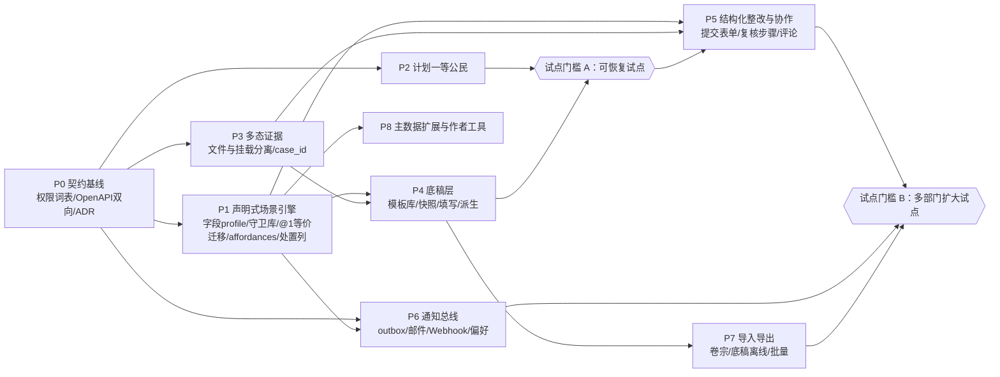

# 04 分阶段演化路线图与里程碑（Roadmap & DoD）

- 状态：提案（RFC），待维护者拍板
- 基线：`origin/main` `5a2804b`（2026-10-13）
- 相关：[README](README.md) · [01 现状与断层](01-current-state-and-gaps.md) · [02 元模型](02-meta-model.md) · [03 扩展与协作](03-extension-and-collaboration.md)

## 1. 演进原则

1. **一个 PR 只做一件事**（AGENTS.md）。下文每个阶段由若干普通 PR 组成，每个 PR 自带测试。
2. **expand → migrate → contract**：凡是改变既有列语义的变更，至少跨两个 PR 或两次发版完成。
   - expand：加新表、新列，旧列保持兼容；
   - migrate：回填数据，读写切到新结构；
   - contract：删除旧列。

   每一步都必须可以回退。
3. **迁移串行合入**。Paseo worktree 共用一个开发数据库（AGENTS.md），各阶段可以在不同 worktree 并行开发，但带迁移的 PR 按依赖顺序逐个合入。
4. **内核零行为漂移**。任何阶段都不修改 `review_cases`、`findings`、`action_items` 的状态集合与包络（[02 §5](02-meta-model.md#5-状态机标注哪些沿用内核)），对这些表只做增列。
5. **规则落在代码、测试和架构检查里**，文档只记录结论。ADR 和 architecture.md 的修订各自走独立 PR（见 §6）。

## 2. 模块依赖图

- P2（计划）和 P3（证据）可以与 P1 并行开发。P6 中 outbox 和分发器的核心可以与 P1 并行；通知规则从场景文档读取的部分要等 P1 完成。
- **P1 排在 P4 之前**：底稿的采集类型、派生时的预填表单、`finish_fieldwork` 守卫都依赖字段 profile 和守卫库。如果先做底稿，就会长出第二套临时校验体系，之后还要返工。

## 3. 通用 DoD（每个 PR）

| 类别 | 要求 |
|---|---|
| 静态检查 | `ruff check .`、`mypy`、`scripts/check_architecture.py`、`scripts/check_openapi.py`（P0 起改为双向）、`scripts/check_error_codes.py` 全部通过 |
| 错误码 | 新增 `RuleCode` 或 `FieldErrorCode` 时，同步更新 `web/src/product/ruleMessages.ts` |
| 后端测试 | 在全新库上跑完全部 PostgreSQL 测试（`EASYAUDIT_RUN_POSTGRES_TESTS=1 pytest`）；每张新表都有跨组织拒绝测试 |
| 并发 | 每条新写路径都有双 Session 竞争测试（`tests/integration/*race*` / `*concurrency*`）；锁后授权沿用 `test_post_lock_authorization_race.py` 的模式 |
| 前端 | `npm run typecheck && npm run lint && npm run test && npm run build && npm run check:entry`；新页面在 375px 下无横向溢出；PR 附桌面端和 375px 截图 |
| OpenAPI | 新接口进入 `openapi/openapi.json`，包括 operationId、tags 和承诺的响应码 |
| 迁移 | 在有数据的库上跑通 `upgrade → downgrade → upgrade`。如果 downgrade 会丢失新形状的数据，则必须**明确拒绝**降级，并有测试固定这一行为（沿用 `alembic/versions/20260827_0011_m3_4_notification_origins.py:120-133` 的做法） |
| 设计说明 | 涉及领域模型、权限、并发、迁移的 PR，描述里写清问题、方案和替代方案；经过跨厂商 review |

## 4. 各阶段

### P0 契约基线（不改变行为）

**改动范围**

| 维度 | 内容 |
|---|---|
| 表与迁移 | 无 |
| 后端 | 新增 `review_core/domain/permissions.py` 权限词表，替换 01 B2 中列出的全部权限字面量；`check_architecture.py` 禁止在词表和 `scenarios/` 之外出现权限字面量；删除或修正 `/meta/domain-model`（01 B11）；`EvidenceResponse.storage_key` 标记为弃用（01 B12，P3 删除） |
| API | 同一个 PR 内**先**更新基线、**再**启用双向检查：①把 17 个缺失的操作（01 B10）写入 `openapi/openapi.json`。条目取自运行时 `create_app().openapi()`，按现有基线的格式只保留 operationId、tags 和承诺的响应码，已有条目不动。②再把 `check_openapi.py` 改为双向检查：运行时存在、但基线里缺失的操作也判为失败 |
| 前端 | 无 |
| 文档与 ADR | 不在 P0 修改既有文档；§6 中的修订各自开独立 PR |

**DoD**
- 单元测试：架构检查的新规则自带正例和反例测试；OpenAPI 双向检查有反例测试，即运行时多出一个操作时检查失败。
- 基线与检查在同一个 PR：`python scripts/check_openapi.py` 在本地和 CI（`check` job）中都**立即通过**。PR 描述列出新增到基线的 17 个操作，供 review 核对。
- API 与集成测试：现有测试**一个都不改**，全部通过。这就是零行为变化的证明。
- 迁移：不涉及。

### P1 声明式场景引擎

**改动范围**

| 维度 | 内容 |
|---|---|
| 表与迁移 | **expand**：新增 `scenario_version_documents`、`scenario_drafts`、`scenario_version_retirements`（含不可变触发器），新增 `findings.disposition_key`（可空）。**migrate**：把 @1 文档内嵌在迁移里写入，并核对 sha256；回填 `disposition_key`（compliance 取 `finding_type`，process 取 `default`）。**contract**：确认回填完整后，`disposition_key` 改为 NOT NULL |
| 后端 | 新增 `review_core/domain/definition/`：格式 v1 元 Schema、字段 profile 校验器、守卫库、包络、`DeclarativeScenarioPolicy`、静态校验器；Registry 改为按 `scenario_version_id` 解析并按 sha256 缓存；组合根接线；`collaboration` 的收件人意图改为从文档读取；代码 @1 保留一个发版周期，只供差分测试使用（Q6） |
| API | 新增 `GET /scenario-versions/{id}/definition`（ETag）；Case/Finding/Action 响应增加 `available_commands` 和 `disposition_key`；新增管理端 `POST /admin/scenario-drafts` 及 `…/validate`、`…/publish`、`…/retire`；CLI 新增 `validate-scenario`、`publish-scenario --file` |
| 前端 | 新增 `web/src/metadata/`（字段 profile、`SchemaForm`、`SchemaDescriptions`）和 `DeclarativeScenarioUi`；页面改为按 `available_commands` 渲染按钮；@1 切换到声明式适配器后，删除 `processReviewV1.tsx`、`complianceReviewV1.tsx` |
| 文档与 ADR | ADR-0007（§6 A1、A3、A11、A14） |

**DoD**
- 单元测试：
  - 守卫库每个守卫都有测试；
  - 字段 profile 一致性语料，pytest 与 vitest 双跑；
  - 引擎属性测试：对任意合法文档，都不会产生包络外的迁移，内核强制守卫始终生效；
  - 静态校验器对 §1.5 的 8 类错误各有反例（见 [03 §1.5](03-extension-and-collaboration.md#15-发布版本与可测试性)）。
- 差分测试：在穷举网格上，代码 @1 与声明式 @1 的判决（目标状态、`RuleCode`、`params`、`errors[]`）逐项相等；PR 中附网格规模统计。
- API 与集成测试：现有 `tests/integration/*` **不改断言**，全部通过；`available_commands` 与实际写入结果一致（对每个 `ready=true` 的命令执行一次写入，全部成功）。
- PostgreSQL 并发测试：两个会话同时发布同一版本，唯一约束裁决，只有一个成功；已发布文档的 UPDATE/DELETE 被触发器拒绝。
- Playwright：
  - 现有 `real-*.spec.ts` 不改断言，全部通过（@1 切换后的回归）；
  - 发布新的示例场景 `sample_review@2`，**全程没有代码改动**，跑通"新建 → 签发 → 整改 → 验证 → 关闭"和"仅记录处置直接关闭"两条旅程。
- OpenAPI：新接口和新字段进入基线。
- 迁移：可以回退；存在非 @1 文档时 downgrade 拒绝执行。

### P2 计划一等公民

**改动范围**

| 维度 | 内容 |
|---|---|
| 表与迁移 | **expand**：`review_plans` 增加 `description`、`lifecycle`（默认 `active`）；新增 `plan_members`。**migrate**：把每个计划的创建者回填为 owner |
| 后端 | 计划授权：可见性规则、`plan.manage`，归档与成员管理在 Plan 锁内进行；进度读侧投影，复用管理视图的指标算法；`create_case` 带 `plan_id` 时，在 Plan 锁内授权，并检查计划为 `active`（修复 01 B1） |
| API | `GET /review-plans` 改为按授权过滤并分页，`GET /review-plans/{id}` 返回 Case 摘要与进度（两个端点已存在，`src/easyaudit_next/api/review_planning.py:246-278`）；新增 `PATCH /review-plans/{id}`、`POST …/archive`、`POST …/unarchive` 和成员增删接口 |
| 前端 | 新增 `/review-plans` 列表页、`/review-plans/:planId` 详情页（概要、活动表、进度卡片、成员）；从详情页追加活动，复用现有路由 `/review-plans/:planId/review-cases/new` |
| 文档与 ADR | design.md 导航与信息架构（§6 A13）；architecture.md 锁序中加入 Plan（§6 A8 的一部分） |

**DoD**
- API 测试：授权矩阵覆盖三种情况：非成员看到 404；Case 成员只能看到自己可见的 Case；owner 能看到全部摘要，但看不到发现项标题（Q2）。
- PostgreSQL 并发测试：归档计划与追加活动并发；同时移除最后一名 owner。
- 读侧：进度查询的 SQL 条数不随数据量增长（分别用 5 条和 100 条数据对比）。
- Playwright：新建计划 → 追加两个活动 → 查看进度 → 归档后无法再追加。
- OpenAPI：新接口进入基线；列表和详情的响应形状变化写进 PR 描述。
- 迁移：可以回退；存在已归档的计划，或存在由回填以外途径加入的成员时，downgrade 拒绝执行。

### P3 多态证据（expand + migrate）

**改动范围**

| 维度 | 内容 |
|---|---|
| 表与迁移 | **expand**：`action_items.case_id`（可空）；`submissions` 增加 `UNIQUE(id, case_id, organization_id)`；`evidences.case_id`（可空）；`evidences.action_item_id` 改为可空；新增 `evidence_attachments`，先支持 finding、action_item 两条弧和以 Case 本身为目标（`target_kind='review_case'`，不需要弧列）；新增 `attachment_retractions`（不可变触发器）。**migrate**：`action_items.case_id` 直接 `UPDATE` 回填（该表没有触发器）。`evidences.case_id` 的回填会被 `evidences_reject_mutation` 拦截，按 [02 §6 第 8 条](02-meta-model.md#6-租户隔离与外键策略) 在迁移内依次执行 `DISABLE TRIGGER` → 回填 → `ENABLE TRIGGER`（取舍见 [02 D8](02-meta-model.md#d8-多态证据)）。两列回填后都设为 NOT NULL，并加复合 FK。最后为每条历史证据 `INSERT` 一条挂载 |
| 后端 | 三段事务上传管线改为"目标解析器"，按目标决定锁序（[02 §7](02-meta-model.md#7-锁顺序扩展)）；下载授权改为基于挂载判断；存储键规则不变，仍为单桶、按组织前缀；`verify-evidence` 和 `cleanup-evidence-orphans` 语义不变 |
| API | 新增 `POST /review-cases/{id}/evidence-uploads`、`POST /findings/{id}/evidence-uploads`、`POST /{target}/evidence-attachments`（挂载已有文件）、`POST /evidence-attachments/{id}/retractions`、`GET /review-cases/{id}/evidences`、`GET /findings/{id}/evidences`；`EvidenceResponse` 删除 `storage_key` |
| 前端 | 新增与目标无关的通用 `EvidencePanel`（上传协议沿用 `docs/design.md:255-259`），用于 Case 详情、Finding 和 Action；作废时必须填写原因，并显示作废历史 |
| 文档与 ADR | ADR-0008；ADR-0005 补充多目标关系的标准写法；architecture.md 新增"在 append-only 表上回填"规则（01 §6 的 A4、A5、A9、A15） |

**DoD**
- 单元测试：目标解析器为每种目标选出的锁序正确；扫描 `alembic/versions/` 的静态测试确认 `DISABLE TRIGGER` 与 `ENABLE TRIGGER` 成对出现，且只用于允许名单内的触发器。
- API 测试：
  - 下载的 404 语义：只要能看到任一挂载目标就可以下载，其余情况一律 404，且不访问对象存储；
  - 跨 Case、跨组织的挂载被 FK 拒绝（直接写库测试）；
  - Case 级证据：只持有 Finding 或 Action 授权的人看不到；`cancelled` 的 Case 拒绝挂载；`closed` 的 Case 允许挂载并写入 Activity。
- PostgreSQL 并发测试：作废与挂载复用并发；上传第 3 段与 Finding 关闭并发（得到 409）。
- 事务边界：`test_evidence_upload_api.py`、`test_evidence_download_api.py` 中"流式传输期间不持有事务"的断言扩展到新目标。
- 运维：`deploy/backup/drill.sh` 通过；`verify-evidence`、`cleanup-evidence-orphans` 的测试不变且全部通过。
- Playwright：在发现项上上传证据、复用证据、作废证据。
- OpenAPI：新接口进入基线，删除 `storage_key` 的变更写进 PR 描述。
- 迁移测试：
  - 回填后每条 `evidences.case_id` 都等于 `action_item → finding` 推导出的 Case；
  - `evidences_reject_mutation` 的 `pg_trigger.tgenabled = 'O'`；
  - 对 `evidences` 执行 `UPDATE`、`DELETE` 仍抛 55000。
- 回退：只有每个文件恰好一条挂载、目标是整改项、且没有作废记录时（即新能力尚未被使用），才允许 downgrade；否则拒绝，避免丢失挂载信息。

### P4 底稿层（contract 证据旧列）→ 试点门槛 A

**改动范围**

| 维度 | 内容 |
|---|---|
| 表与迁移 | 新增 `checklist_templates`、`checklist_template_versions`（不可变触发器）、`worksheets`、`worksheet_sections`、`worksheet_items`（列级不可变触发器）、`worksheet_item_revisions`（append-only）、`worksheet_participants`、`finding_source_items`（部分唯一索引）；`evidence_attachments` 增加 `worksheet_item_id` 弧；`activities` 增加 `worksheet_id` 弧；**contract**：删除 `evidences.action_item_id` |
| 后端 | 新建 `worksheets/` 模块，应用服务用组合接入，不继承（01 B4）；快照用多值 INSERT 在短事务内批量写入；新增守卫 `worksheets_completed`、`nonconformities_resolved`；权限词表加入新权限；新增完成度读侧投影 |
| API | 模板：草稿、XLSX 导入（validate/apply）、发布、退役；`POST /review-cases/{id}/worksheets`（挂载并生成快照）；`GET /review-cases/{id}/worksheets`；`GET /worksheets/{id}`（含完成度）；`PUT /worksheets/{id}/responses`（批量保存，带期望 revision）；`POST …/complete`、`…/reopen`、`…/cancel`；`POST /worksheets/{id}/derive-findings`；`POST /worksheet-items/{id}/finding-links`；`POST /worksheet-items/{id}/evidence-uploads` |
| 前端 | 管理设置新增"检查模板"（导入、预览、发布）；Case 详情页新增"执行底稿"标签页；底稿填写页；派生抽屉；Finding 详情页新增"来源检查项" |
| 文档与 ADR | ADR-0010；domain.md 增加底稿相关概念；architecture.md 锁序与 409 携带 code（§6 A7、A8、A10） |

**DoD**
- 单元测试：
  - 测量判定的边界：含边界与不含边界、精度、无规格、人工改判必须给原因；
  - 完成度规则：不适用必须有原因；证据要求只计未作废的挂载；
  - 多选取最差结果。
- PostgreSQL 并发测试：
  - 两人同时保存同一项：只有一方成功，另一方得到 409 `revision_conflict`；
  - 重复点击派生：只产生一个 Finding，另一方得到 409 `already_derived`；
  - 撤销角色与填写并发：锁后授权生效；
  - 带守卫的 `finish_fieldwork` 与重开底稿并发；
  - 模板版本并发发布。
- 性能：300 项底稿的读取，查询条数固定；记录批量保存的 P95。
- 导入：逐行错误报告、全有或全无、重复导入幂等、zip bomb 防护。
- Playwright 全旅程：导入模板 → 发布 → 挂载到 Case → 填写（包括超出规格的测量项和"不适用"）→ 合并两项派生发现项 → 整改 → 验证 → `finish_fieldwork` 守卫生效 → 关闭；375px 下无横向溢出。
- OpenAPI：新接口进入基线。
- 迁移：可以回退；存在底稿数据时 downgrade 拒绝执行。contract 步骤（删除 `evidences.action_item_id`）单独提一个 PR。它的 downgrade 要从挂载表回填这一列，同样按 02 §6 第 8 条暂停并恢复 `evidences_reject_mutation`，并配同样的触发器断言。

### P5 结构化整改与协作

**改动范围**

| 维度 | 内容 |
|---|---|
| 表与迁移 | 新增 `action_items.scenario_data`；新增 `comments`、`comment_mentions`、`comment_retractions`（不可变触发器）；`evidence_attachments` 增加 comment、submission 两条弧 |
| 后端 | 提交表单改由文档驱动（@1 行为不变）；新增复核步骤与计划审批（守卫 `plan_approved`、`prior_steps_approved`）；工作台的"待我复核"改为按当前待办步骤投影；新增合并时间线的读侧 |
| API | `POST /{target}/comments`、`POST /comments/{id}/retractions`、`GET /{target}/timeline`；提交接口改为按表单引用校验 payload |
| 前端 | 由 `SchemaForm` 驱动的分段提交抽屉；多步复核的进度展示；评论区（`@提及` 用 `Select showSearch` + 授权候选接口）；时间线 |
| 文档与 ADR | domain.md 增加 Comment、复核步骤 |

**DoD**
- 单元测试：复核步骤的语义：第 2 步驳回后回到 `rectifying`；重新提交后，之前各步的通过全部失效；计划未审批时不能提交完成。
- API 测试：评论授权按目标构造（只是 Action 执行人的人看不到 Case 级评论）；客户端提交的保留键会被拒绝；超出表单定义的字段返回 `unknown_field`。
- PostgreSQL 并发测试：两名复核员同时通过末步，其中一方得到 409。
- Playwright：两步复核旅程；用评论补充材料，不经过驳回。
- OpenAPI：新接口进入基线。
- 迁移：可以回退；存在评论或步骤提交时，downgrade 拒绝执行。

### P6 通知总线 → 试点门槛 B 的一部分

**改动范围**

| 维度 | 内容 |
|---|---|
| 表与迁移 | 新增 `outbound_messages`、`webhook_endpoints`、`user_contact_points`、`user_notification_preferences`。"类别 + 事件键"**不改 `notifications` 表**：`kind` 继续作为事件键，旧值保持不变，类别由读侧代码映射，因此不需要回填（`trg_notifications_immutable` 会拒绝回填）。如果需要给 `notifications` 新增列（例如底稿通知的 `worksheet_id` 主体弧），必须在同一个迁移里 `CREATE OR REPLACE` `enforce_notification_immutability()`，把新列加入不可变清单（02 §6 第 8 条） |
| 后端 | 新增 `EventRouter`，取代命令式调用（01 B9），规则来自场景文档；新增 `infrastructure/smtp.py`、`infrastructure/webhook.py`；新增 CLI `dispatch-outbound`、`outbound-status`、`retry-outbound`；Settings 增加 `SMTP_*`、`OUTBOUND_*`，主密钥通过 `*_FILE` 注入；`check_architecture.py` 禁止 Web 进程 import 分发器 |
| 部署 | `deploy/` 新增 dispatcher 的 timer 和 service，以及 `outbound` 网络（非 internal，只有 dispatcher 加入） |
| API | 个人联系方式与偏好的读写接口；管理端 Webhook 的增删改、测试事件、最近投递状态 |
| 前端 | 个人设置（联系方式、偏好）；管理设置里的 Webhook（密钥只在创建时显示一次、发送测试事件、查看投递状态） |
| 文档与 ADR | ADR-0009；修订 ADR-0001 和 architecture.md 的"通知与提醒"一节（§6 A2、A6） |

**DoD**
- 单元测试：退避与转入 `dead` 的逻辑用假时钟测试；签名有测试向量；SSRF 防护：不在白名单内、解析到不允许的地址、发生重定向，三种情况都被拒绝。
- PostgreSQL 并发测试：
  - 业务事务回滚时不留下 outbox 行；
  - 两个分发进程并发运行，不会重复领取（`SKIP LOCKED` 加租约）；
  - 租约过期后可以被重新领取。
- 集成测试：
  - 发送前重新校验收件人的可见性；
  - 用本地 SMTP 测试服务器（开发依赖）跑端到端；
  - 用本地 HTTP 测试接收端验证签名与幂等；
  - `scheduler-status` 的新鲜度检查覆盖新 job。
- 部署测试：`tests/unit/test_deploy_compose.py` 断言只有 dispatcher 在 `outbound` 网络上。
- Playwright：在个人设置中修改偏好；在管理设置中创建 Webhook 并查看投递状态。
- OpenAPI：新接口进入基线。
- 迁移：可以回退；存在未投递消息时，downgrade 拒绝执行。

### P7 导入导出 → 试点门槛 B 的一部分

**改动范围**

| 维度 | 内容 |
|---|---|
| 表与迁移 | 无（可能增加导出审计事件，取决于 Q9） |
| 后端 | 流式生成卷宗 ZIP；在仓库内维护 `schemas/export/*.json`；底稿离线 XLSX 的导出与回传；用户与部门 CSV 导入 |
| API | `GET /review-cases/{id}/dossier`；`GET /worksheets/{id}/export.xlsx`、`POST /worksheets/{id}/import?mode=validate\|apply`；`POST /admin/users/import?mode=…`、`POST /admin/departments/import?mode=…` |
| 前端 | Case 详情页提供卷宗导出；底稿页提供离线导出与回传，并展示逐行报告；管理设置提供批量导入 |
| 文档与 ADR | architecture.md 的"读侧"一节补充卷宗导出规则 |

**DoD**
- 单元测试：zip bomb 和公式注入防护；导出的 JSON 能通过自身的 JSON Schema 校验。
- API 测试：
  - 授权过滤；超出上限时返回 422；
  - 同一快照导出两次，JSON 逐字节相同；
  - 导入全有或全无，且重复导入幂等。
- 事务边界：流式导出期间不持有事务（通过 `pg_stat_activity` 断言）。
- Playwright：下载卷宗，核对 manifest，并用 `checksums.sha256` 校验内容。
- OpenAPI：新接口进入基线。
- 迁移：不涉及。

### P8 主数据扩展与作者工具

**改动范围**

| 维度 | 内容 |
|---|---|
| 表与迁移 | 新增 `attribute_schema_versions`；`users.attributes`、`departments.attributes`（JSONB）；`department_memberships`（取决于 Q8） |
| 后端 | 扩展属性校验，复用字段 profile；候选接口支持按 `org_visible` 属性筛选；数据保留设计（Q12） |
| API | 扩展属性定义的管理接口；场景草稿和模板草稿的结构化编辑接口 |
| 前端 | 场景草稿和模板草稿的**表单化编辑与预览**：结构化编辑器，显示静态校验结果和 examples 运行结果，**不做**拖拽设计器 |
| 文档与 ADR | ADR-0002（只有 Q1 或 Q8 需要时才修订） |

**DoD**
- 单元测试：属性校验复用字段 profile 的一致性语料。
- API 测试：候选接口按属性筛选，但授权范围不变。
- 前端：草稿编辑器的预览结果与发布时的校验结果一致。
- Playwright：编辑草稿、预览，然后发布。
- OpenAPI：新接口进入基线。
- 迁移：可以回退。

## 5. 试点价值门槛

| 门槛 | 包含阶段 | 试点时用户能做什么 |
|---|---|---|
| **A：恢复试点** | P0–P4（建议 P5 中的评论同批完成） | 在计划下成批安排审查活动；按模板执行底稿；逐项记录合格、不合格和实测值；就地附证据；一键派生发现项；完成整改、验证、关闭的闭环；查看计划进度。这正是缺失的"审查执行层" |
| **B：扩大到多部门** | A + P5、P6、P7 | 结构化整改反馈、多步复核、评论协作；通过邮件和 Webhook 触达；卷宗导出归档；底稿离线填写 |
| C：长期 | B + P8 | 组织自助管理扩展属性，使用模板与场景的编写工具 |

试点上线仍按 [pilot-launch.md](../../operations/pilot-launch.md) 的检查清单执行，本文不另设上线清单。

## 6. 后续文档 PR 清单（本 RFC 不修改这些文件）

建议措辞见 [01 §6](01-current-state-and-gaps.md#6-需修订的-adr-与-architecturemd-条目建议措辞在后续-pr-中修改本-pr-不动)。

| PR | 内容 | 与哪个阶段一起合入 |
|---|---|---|
| docs: ADR-0007 + ADR-0003 状态修订 | A1、A3、A11、A14 | P1 第一个 PR 之前 |
| docs: ADR-0008 + ADR-0005 补充 + append-only 回填规则 | A4、A5、A9、A15 | P3 之前 |
| docs: ADR-0010 + domain/architecture 底稿与锁序 | A7、A8、A10 | P4 之前 |
| docs: ADR-0009 + ADR-0001 修订 | A2、A6 | P6 之前 |
| docs: design.md 导航与新页面规范 | A13 | P2、P4 前端 PR 之前 |
| docs: ADR-0002 修订（视情况） | A12 | 只有 Q1 或 Q8 需要时才做 |

## 7. 风险登记

| # | 风险 | 可能性/影响 | 缓解 | 触发信号 |
|---|---|---|---|---|
| R1 | 引擎逐渐被扩成通用工作流引擎 | 中/高 | 包络和守卫库保持封闭；ADR-0007 写明准入条件；扩展包络必须走 ADR | 一个季度内出现 3 个以上"需要新守卫"的 PR |
| R2 | @1 声明式实现与原代码存在细微偏差（错误码、校验顺序） | 中/中 | 穷举差分测试；现有测试不改断言；代码 @1 保留一个发版周期 | 差分网格出现不相等的项 |
| R3 | Case 锁使同一 Case 内的底稿填写串行 | 中/中 | 短事务；批量保存；压测；必要时再专门评估 | 批量保存 P95 超过 300ms，或出现 55P03 |
| R4 | 外发通道导致数据外泄或 SSRF | 低/高 | 默认只发薄事件；主机白名单；发送时复核可见性；独立的出网网络 | 安全评审提出意见 |
| R5 | 证据迁移破坏备份与恢复链路，或回填后 append-only 触发器没有恢复 | 低/高 | expand/contract 分步；恢复演练必须通过；迁移测试断言触发器已重新启用、且 `UPDATE`/`DELETE` 仍被拒绝；静态测试检查 DISABLE 与 ENABLE 成对出现 | `drill.sh` 失败，或触发器断言失败 |
| R6 | 范围膨胀，试点一再推迟 | 高/中 | 门槛 A 定义清晰；P5 及以后的阶段按真实反馈排序 | 门槛 A 的工期超出估计 50% |
| R7 | 修订记录、评论、outbox 的数据持续增长 | 中/低 | 先测量，再并入数据保留设计 | 单表超过百万行 |
| R8 | 前后端校验器结论不一致 | 中/中 | 共享一致性语料；以服务端结论为准；前端遇未知情况 fail-closed | 语料在 vitest 中失败 |
| R9 | 大模板挂载时快照写入过慢 | 低/中 | 多值 INSERT 批量写入，保持短事务；压测 | 挂载 300 项超过 1 秒 |

## 8. 需要维护者拍板的问题（含推荐默认值）

| # | 问题 | 推荐默认值 | 影响阶段 |
|---|---|---|---|
| Q1 | 场景文档和检查模板由谁编写、发布？模板能否跨组织共享？ | 先只允许 `system_admin`，与现有 `publish-scenario` 一致；模板不跨组织共享，需要复用时通过文件导出、导入；有真实需求时再引入组织级"模板管理"角色（需修订 ADR-0002） | P1、P4 |
| Q2 | 计划 owner 不是某个 Case 的成员时，能看到什么？ | 能看到 Case 摘要投影，看不到发现项标题和明细 | P2 |
| Q3 | 邮件和 Webhook 携带多少内容？ | 默认 `minimal`（类别、ID、链接）；`summary` 由每个端点单独开启，并写平台审计 | P6 |
| Q4 | 外发分发怎么调度？ | 每分钟运行一次 timer；对延迟有硬性要求时，再评估常驻 worker | P6 |
| Q5 | 导入遇到错误时怎么处理？ | 全有或全无，附逐行报告 | P4、P7 |
| Q6 | 代码实现的 @1 何时退役？ | 差分测试通过后的下一个发版删除 | P1 |
| Q7 | 是否允许在 `open` 状态下修改处置类型？ | 允许，作为独立命令 `reclassify`，必须填原因，写 Activity | P1 |
| Q8 | 是否支持多部门隶属，是否把"部门负责人"作为收件人？ | 门槛 A 不做，门槛 B 之前根据试点反馈再定 | P8 |
| Q9 | 卷宗导出同步还是异步？是否写平台审计？ | 同步流式输出，设大小上限；写平台审计（因为导出内容包含证据文件） | P7 |
| Q10 | 是否同意修订"明确不做"、ADR-0001、ADR-0003 的措辞？是否接受"迁移内按名暂停 append-only 触发器再回填"的规则（A15）？ | 都同意，按 01 §6 的建议措辞修订。如果不接受 A15，证据的 Case 归属改用只插入的归属表（02 D8 方案 B） | P0 之后的文档 PR、P3 |
| Q11 | 能否在 `scheduled` 状态下预填底稿？ | 由场景文档在包络内声明，默认不允许 | P4 |
| Q12 | 修订记录、评论、outbox 保留多久？撤回评论的原文是否保留在审计导出中？ | 暂不清理，与"数据保留"一起设计 | P5、P6 |
